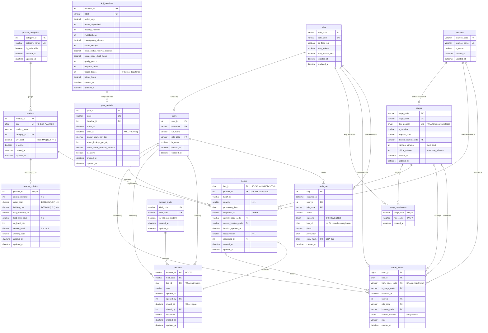

# Entity relationship diagram

The diagram matches [`database/schema.sql`](../database/schema.sql) table for
table and column for column. GitHub renders the Mermaid block below as a
diagram. To export it as an image, paste the block into <https://mermaid.live>
or run `npx @mermaid-js/mermaid-cli -i erd.mmd -o docs/erd.png`.

Key: **PK** primary key · **FK** foreign key · **UK** unique key.
Crow's-foot notation: `||` exactly one, `o|` zero or one, `|{` one or more,
`o{` zero or more.

## Relationships

| Relationship | Type | How it is stored |
|---|---|---|
| product_categories → products | one-to-many | `products.category_id` FK |
| products → reorder_policies | one-to-one | `reorder_policies.product_id` is both PK and FK |
| products → boxes | one-to-many | `boxes.product_id` FK |
| roles → users | one-to-many | `users.role_code` FK |
| **stages ↔ roles** | **many-to-many** | resolved by the link table **`stage_permissions`** (composite PK `stage_code, role_code`) |
| locations → stages | one-to-many | `stages.default_location_code` FK |
| stages / locations / users → boxes | one-to-many | `current_stage_code`, `current_location_code`, `registered_by` FKs |
| boxes → status_events | one-to-many (at least one) | `status_events.box_id` FK |
| stages → status_events | one-to-many (twice) | `from_stage_code` (nullable), `to_stage_code` FKs |
| users / roles / locations → status_events | one-to-many | `user_id`, `role_code`, `location_code` FKs |
| incident_kinds → incidents | one-to-many | `incidents.kind_code` FK |
| boxes → incidents | zero-or-one-to-many | `incidents.box_id` FK (nullable) |
| users → incidents | one-to-many (twice) | `opened_by`, `closed_by` (nullable) FKs |
| users / roles → audit_log | one-to-many | `user_id`, `role_code` FKs |
| kpi_baselines → pilot_periods | one-to-many | `pilot_periods.baseline_id` FK |

## Indexes

Every primary and foreign key is indexed. Additional lookup and composite indexes:

| Table | Index | Columns | Used for |
|---|---|---|---|
| products | `uq_products_sku` (unique) | `sku` | SKU lookups, no duplicate SKUs |
| users | `ix_users_role_active` | `role_code, is_active` | active user for a role |
| boxes | `uq_boxes_product_day_sequence` (unique) | `product_id, production_date, sequence_no` | one label ID per box per day |
| boxes | `ix_boxes_stage_location` | `current_stage_code, current_location_code` | box board filters, "what is at QC now" |
| boxes | `ix_boxes_batch` | `batch_no` | batch recall |
| status_events | `ix_status_events_box_time` | `box_id, occurred_at` | a box's history in order |
| status_events | `ix_status_events_stage_time` | `to_stage_code, occurred_at` | dwell and throughput KPIs |
| incidents | `ix_incidents_status` | `closed_at, kind_code` | open investigations (`closed_at IS NULL`) |
| incidents | `ix_incidents_kind_opened` | `kind_code, opened_at` | incident rate per period |
| audit_log | `uq_audit_log_entry_hash` (unique) | `entry_hash` | tamper evidence |
| audit_log | `ix_audit_log_box_seq` | `box_id, seq` | audit trail for one box |
| audit_log | `ix_audit_log_action_outcome` | `action, outcome` | rejected-attempt reports |
| pilot_periods | `ix_pilot_periods_active` | `is_active, starts_at` | the current pilot |

## Design notes (normalisation)

* **3NF.** Supplier-style repetition is avoided: category details live in
  `product_categories`; product details are never copied into `boxes`;
  usernames and role labels are referenced by key, not repeated.
  Perishability depends on the category, so it is stored there, not per product.
* **`boxes.current_stage_code`** is the one deliberate copy: it equals the
  latest `status_events.to_stage_code` and is written in the same transaction
  as the event, so the box board can filter by stage through an index instead
  of reading every box's history. A test checks the two always agree.
* **`status_events.role_code` / `audit_log.role_code`** record the role the
  user held *at the time*; a user's role can change later, so this is history,
  not duplication.
* **`audit_log.box_id`** has no foreign key on purpose: a rejected scan of an
  unregistered label must still be recorded with the text that was scanned.
* **Money** uses `DECIMAL(10,2)`; timestamps use `DATETIME(6)` (UTC) where
  microseconds matter for ordering and for the audit hash.
* `created_at` / `updated_at` audit fields are on every main table. The
  append-only logs (`status_events`, `audit_log`) and the link table only
  have `created_at`, because their rows are never updated.
